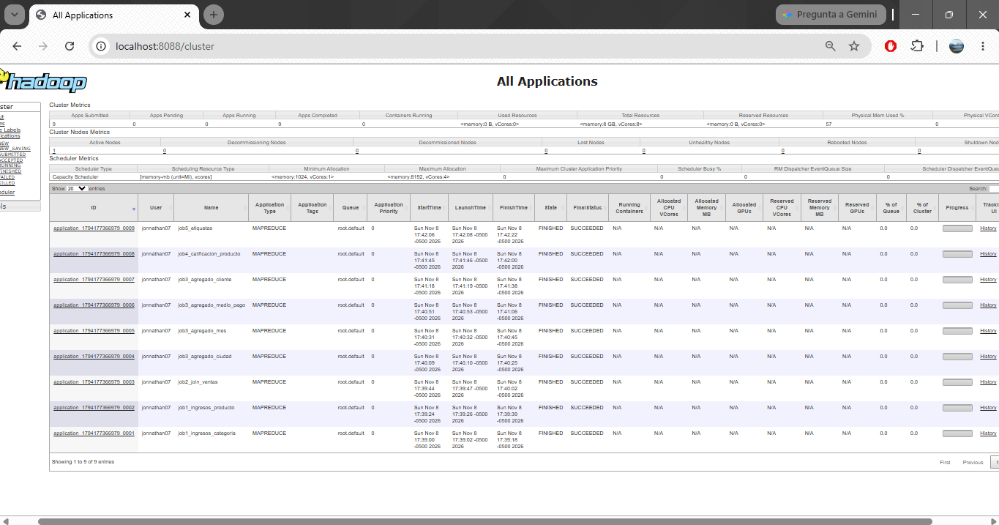

# Análisis de Big Data con Apache Hadoop y MapReduce

Práctica del curso **Big Data** — Universidad de Cundinamarca
Docente: Cristian Orjuela · Estudiante: Jonnathan Pazos

Análisis de los datos de ventas y reseñas de una tienda (actividad anterior) con el
paradigma MapReduce, usando **Hadoop Streaming** y programas mapper/reducer en Python 3.

## Estructura

```
data/                        Datos de entrada (CSV y JSON de la actividad anterior)
scripts/json_a_jsonl.py      Preprocesamiento: JSON multilínea -> JSON Lines
scripts/graficos.py          Gráficos a partir de las salidas de los jobs
mapreduce/
  job1_ingresos_categoria/   Ingresos y unidades por categoría/producto (join en el mapa)
  job2_join_ventas/          Join en el reduce: ventas + detalle_venta (+ clientes)
  job3_agregados/            Job encadenado: ventas por ciudad, mes, medio de pago, cliente
  job4_calificacion_producto/ Estadísticas de reseñas por producto (datos semiestructurados)
  job5_etiquetas/            Frecuencia de etiquetas (patrón WordCount)
results/                     Salidas (.tsv), log de ejecución y gráficos
run_local.sh                 Prueba local: cat | mapper | sort | reducer
run_hadoop.sh                Carga a HDFS y ejecución de los jobs en Hadoop
```

## Ejecución

Prueba local (sin Hadoop, valida la lógica):

```bash
./run_local.sh
python3 scripts/graficos.py
```

En Hadoop (HDFS y YARN activos, `HADOOP_HOME` definido):

```bash
start-dfs.sh && start-yarn.sh
./run_hadoop.sh
```

## Evidencias de ejecución

Ejecutado en Apache Hadoop 3.4.1 (modo pseudodistribuido) sobre Ubuntu 26.04 en WSL 2, con OpenJDK 11.
Los 9 jobs terminaron con estado `SUCCEEDED` en YARN.

- Registro completo de la ejecución: [`results/hadoop_log.txt`](results/hadoop_log.txt)
- Capturas: [`docs/evidencias/`](docs/evidencias/)



## Resultados principales

| Indicador | Valor |
|---|---|
| Ingresos totales | $52.385.000 COP en 30 ventas |
| Categoría líder | Tecnología: $36.180.000 (69,1 %) |
| Producto líder | Portátil 14 pulgadas: $19.600.000 (37,4 %) |
| Ciudad líder | Zipaquirá: $33.500.000 (63,9 %) |
| Calificación promedio | 3,88 / 5 (40 reseñas) |
| Etiqueta más asociada a reseñas bajas | precio (50 % en calificaciones ≤ 3) |
